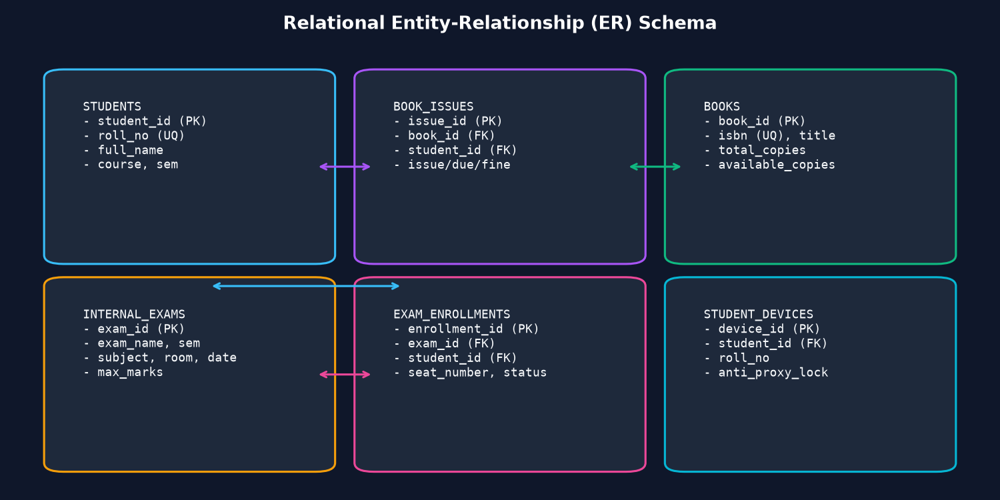
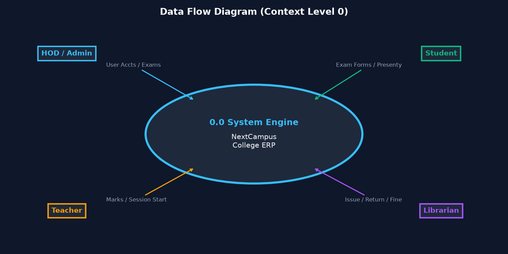
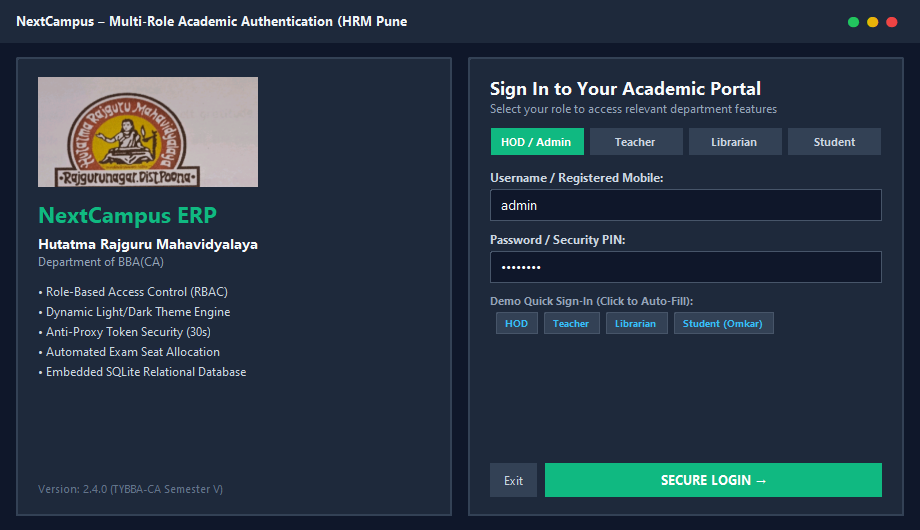
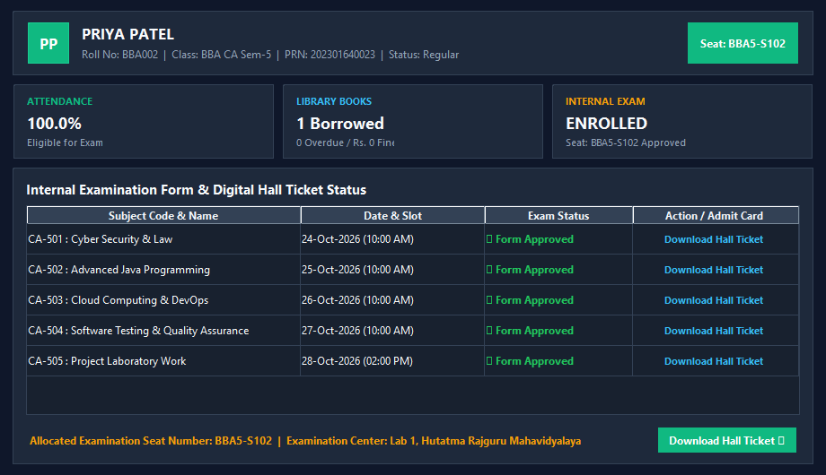
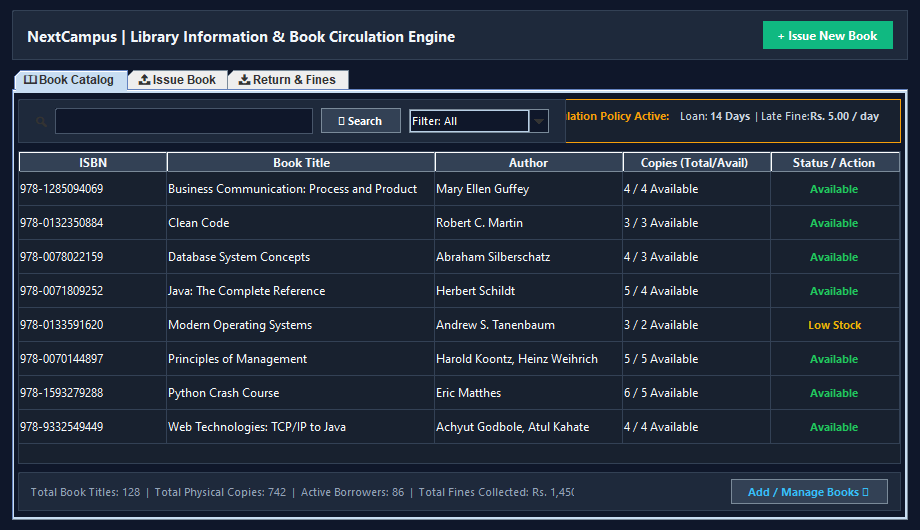
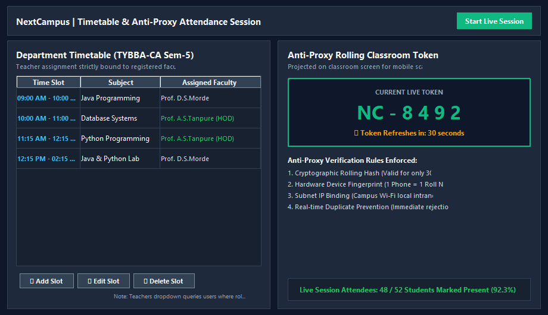
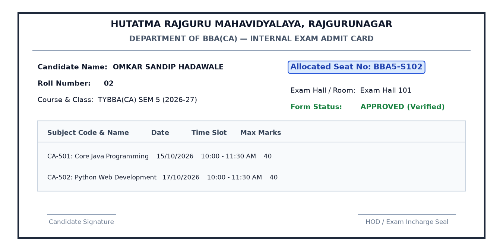

# Khed Taluka Shikshan Prasarak Mandal's
# Hutatma Rajguru Mahavidyalaya, Rajgurunagar, Pune- 410505

 

### **TYBBA(CA)**
### **Div-A**

 

### Project Report On
# **"NEXTCAMPUS - COLLEGE STUDENT & LIBRARY MANAGEMENT SYSTEM"**

  

### **Developed By,**
### **Name: Omkar Sandip Hadawale**
### **Roll no: 02**

  

### **Under Guidance**
### **Prof. A.S. Tanpure**
### **(2025-2026)**

---

  

# DECLARATION OF STUDENT

 

I hereby declare that the content of this Project report is my original work and has not been submitted for any other academic assessment. I have duly acknowledged all sources of information, including words, data, arguments, and ideas. This report adheres to the guidelines and standards of the university.

    

**Omkar Sandip Hadawale**  
**BBA(CA) Department**

---

 

# CERTIFICATE

### Khed Taluka Shikshan Prasarak Mandal's
### Hutatma Rajguru Mahavidyalaya, Rajgurunagar, Pune- 410505

 

This is to certify that **Mr. Omkar Sandip Hadawale** has satisfactorily carried out his project entitled **"NEXTCAMPUS - COLLEGE STUDENT & LIBRARY MANAGEMENT SYSTEM"** in partial fulfilment of the requirement of the Degree of **TYBBA(CA)**, during **Sem-V** of the Academic Year **2025-2026** under Savitribai Phule Pune University.

   

| **Prof. A.S. Tanpure** | **Prof. A.S. Tanpure** | **Dr. S.S. Pingale** |
| :--- | :---: | ---: |
| **Project Guide** | **HOD** | **Principal** |

   

**External Examiner**

---

  

# ACKNOWLEDGEMENT

 

With immense Pleasure, I Mr. Omkar Sandip Hadawale presenting a report on **"NEXTCAMPUS - COLLEGE STUDENT & LIBRARY MANAGEMENT SYSTEM"** project as a part of curriculum of the **TYBBA(CA)**. I wish to thank all the people who gave us unending support right from when the idea was conceived. I express my sincere and profound thanks to our guide **Prof. A.S. Tanpure** for giving me valuable guidance and pointing me in the right direction.

I also convey my sincere gratitude to **Dr. S.S. Pingale**, Principal of Hutatma Rajguru Mahavidyalaya, and the college management for providing outstanding computing facilities and laboratory infrastructure. Finally, I thank all faculty members and staff of the BBA(CA) Department for their continuous cooperation, encouragement, and kind support.

    

**Omkar Sandip Hadawale**  
**BBA(CA)**

---

 

# INDEX

| Sr. No. | Documentation Format Topic | Page No. |
| :---: | :--- | :---: |
| **1.** | **Abstract** | **1** |
| **2.** | **Introduction** | **2** |
| | &nbsp;&nbsp;&nbsp;&nbsp;2.1 Motivation | 2 |
| | &nbsp;&nbsp;&nbsp;&nbsp;2.2 Problem Statement | 3 |
| | &nbsp;&nbsp;&nbsp;&nbsp;2.3 Purpose / Objective and Goals | 3 |
| | &nbsp;&nbsp;&nbsp;&nbsp;2.4 Literature Survey | 4 |
| | &nbsp;&nbsp;&nbsp;&nbsp;2.5 Project Scope | 5 |
| **3.** | **System Analysis** | **6** |
| | &nbsp;&nbsp;&nbsp;&nbsp;3.1 Existing Systems | 6 |
| | &nbsp;&nbsp;&nbsp;&nbsp;3.2 Scope and Limitations of Existing Systems | 7 |
| | &nbsp;&nbsp;&nbsp;&nbsp;3.3 Project Perspective, Features | 7 |
| | &nbsp;&nbsp;&nbsp;&nbsp;3.4 Stakeholders | 8 |
| | &nbsp;&nbsp;&nbsp;&nbsp;3.5 Requirement Analysis (Functional, Performance, Security) | 9 |
| **4.** | **System Design** | **10** |
| | &nbsp;&nbsp;&nbsp;&nbsp;4.1 Design Constraints | 10 |
| | &nbsp;&nbsp;&nbsp;&nbsp;4.2 System Model: ERD & DFD (Context Level) | 11 |
| | &nbsp;&nbsp;&nbsp;&nbsp;4.3 Data Model | 13 |
| | &nbsp;&nbsp;&nbsp;&nbsp;4.4 User Interface | 15 |
| **5.** | **Implementation Details** | **17** |
| | &nbsp;&nbsp;&nbsp;&nbsp;5.1 Software / Hardware Specifications | 17 |
| **6.** | **System Outputs and Validation** | **19** |
| | &nbsp;&nbsp;&nbsp;&nbsp;6.1 Output Screen | 19 |
| | &nbsp;&nbsp;&nbsp;&nbsp;6.2 Input Validation | 21 |
| | &nbsp;&nbsp;&nbsp;&nbsp;6.3 Report Format | 22 |
| **7.** | **Conclusion and Recommendations Limitations & Future Scope** | **23** |
| **8.** | **Bibliography and References** | **25** |

---

 

# 1. Abstract

The project **"NEXTCAMPUS - COLLEGE STUDENT & LIBRARY MANAGEMENT SYSTEM"** is an integrated, role-based desktop and mobile web management platform designed specifically for collegiate academic administration. The system aims to streamline essential academic operations including student profile management, role-based access control (RBAC), library circulation with automated fine calculations, internal examination form enrollment, automated sequential seat number allocation, smart anti-proxy mobile attendance, and subject-wise internal continuous assessment marks tracking.

In educational institutions, manual paper-based registers, physical exam forms, and traditional roll calls frequently lead to proxy attendance, library overdue fine disputes, seat number allocation delays, and scattered records. NextCampus resolves these challenges by combining a desktop Java Swing application for administrative efficiency, a Python Flask mobile service for student self-service over campus Wi-Fi, and a zero-configuration embedded SQLite database.

By enforcing strict role-based separation (Admin/HOD, Teacher, Librarian, Student), cryptographic 30-second rolling tokens for attendance, 14-day book loans with automated Rs. 5/day fine tracking, and 1-click exam hall ticket generation, NextCampus delivers high operational transparency, eliminates proxy attendance, and elevates academic efficiency at Hutatma Rajguru Mahavidyalaya.

  

<b>1</b>

---

 

# 2. Introduction

### 2.1 Motivation
In modern colleges like Hutatma Rajguru Mahavidyalaya, administrative staff and faculty invest substantial hours each week handling repetitive paperwork: manually maintaining library registers, computing overdue book fines, managing paper exam forms, sorting students to assign seat numbers, distributing hall tickets, and conducting attendance roll calls where proxy attendance is common. Experiencing these bottlenecks firsthand during the TYBBA(CA) program served as the primary motivation to build NextCampus: a unified, secure, click-driven software solution that centralizes and modernizes collegiate administration.

### 2.2 Problem Statement
Existing departmental processes rely on manual logs and disjointed spreadsheets, resulting in serious operational deficiencies:
- **Library Borrowing Bottlenecks**: Manual ledgers cause delays, misplaced cards, and frequent disputes over late fines.
- **Exam Enrollment & Hall Ticket Delays**: Students endure long queues to submit exam forms, while faculty spend days manually assigning seat numbers.
- **Classroom Attendance Proxy**: Paper roll calls and static QR codes permit absent students to have friends mark attendance for them.
- **Scattered Student Records**: Academic profiles, marks, library loans, and attendance exist in separate registers, preventing a unified 360-degree view.

### 2.3 Purpose / Objective and Goals
The primary purpose of NextCampus is to establish an offline-first, high-speed college information and ERP system. Key objectives include:
- **Zero-Configuration Database**: Utilize embedded SQLite (`college_sms.db`) requiring zero server installation or maintenance.
- **Integrated Library Engine**: Automate cataloging, real-time availability checks, 14-day loan policies, and Rs. 5/day overdue fine billing.
- **Automated Exam Seat Allocation**: Enable 1-click student exam enrollment, faculty review, sequential seat numbers (e.g. `BBA5-S101`), and digital hall tickets.
- **Smart Anti-Proxy Mobile Attendance**: Implement 30-second cryptographic rolling classroom tokens and smartphone hardware binding.
- **Role-Based Security**: Provide dedicated dashboards and permissions for Admin/HOD, Teachers, Librarians, and Students.

### 2.4 Literature Survey
A survey of current educational management systems highlighted clear trade-offs:
- **Commercial ERPs (SAP Campus, ERPNext)**: Powerful but require expensive annual licenses, dedicated cloud servers, and complex training.
- **Standalone Library Software (Koha)**: Manages books effectively but is completely detached from college exam seats and student attendance.
- **Legacy Desktop Tools (VB6, MS Access)**: Outdated interfaces, prone to database corruption, and lack mobile network integration.
- **Static QR Code Attendance Apps**: Easily bypassed by students photographing and sharing QR codes via messaging apps.

**Inference**: NextCampus bridges these gaps by pairing Java Swing desktop robustness with lightweight Python Flask mobile capabilities and zero-config embedded storage, providing an affordable, robust solution tailored for college departments.

### 2.5 Project Scope
The scope of NextCampus covers the 3-year undergraduate BBA(CA) curriculum across Semester 1 to Semester 6, focusing on:
- **Core Academic Modules**: Student Directory, Multi-Role Authentication, Library Circulation, Internal Exam Enrollment & Hall Tickets, Timetable Management, and Smart Attendance.
- **Hardware & Network Scope**: Departmental local area network (LAN/Wi-Fi) operation without internet or cloud hosting dependency.

  

<b>2</b>

---

 

# 3. System Analysis

### 3.1 Existing Systems
Currently, department operations at the college rely on a combination of handwritten registers and standalone spreadsheet files. Library issues are documented on physical borrower cards. Exam applications are collected via printed paper forms, and attendance is recorded using roll-call registers.

### 3.2 Scope and Limitations of Existing Systems
- **Data Redundancy & Inconsistency**: Student information is duplicated across library records, exam sheets, and attendance registers.
- **Proxy Attendance**: Traditional roll call allows students to respond on behalf of absent peers without verification.
- **Human Error in Fine Calculation**: Manual calculation of overdue library fines is time-consuming and prone to computational errors.
- **Paper Wastage & Storage Vulnerability**: Physical registers deteriorate over time and risk data loss from physical damage.

### 3.3 Project Perspective, Features
NextCampus functions as a self-contained intranet academic suite. Key architectural features include:
- Modular multi-tier architecture isolating UI, business logic, and embedded storage.
- Dynamic dual-theme rendering supporting comfortable Midnight Slate Dark Mode and non-glare Executive Light Mode.
- Strict timetable assignment restricted exclusively to faculty registered in the software database.

### 3.4 Stakeholders
- **Head of Department (HOD) / Administrator**: Full system oversight, student record management, timetable configuration, and exam activation.
- **Teachers / Faculty**: Internal continuous assessment mark entry, practical journal verification, and launching live anti-proxy attendance sessions.
- **Librarians**: Catalog management, issuing/returning books, monitoring copy availability, and collecting overdue fines.
- **Students**: Accessing academic profiles, submitting exam forms, viewing allocated seat numbers, downloading hall tickets, and marking mobile attendance.

### 3.5 Requirement Analysis
1. **Functional Requirements**:
   - *User Authentication*: Multi-role authentication (Admin, Teacher, Librarian, Student) with hashed credential verification.
   - *Library Management*: Real-time inventory tracking, 14-day borrowing rules, automated fine computation at Rs. 5 per day.
   - *Exam Management*: Form status verification, auto-generation of sequential seat numbers (`BBA5-S101`), and digital hall tickets.
   - *Smart Presenty*: Rolling 30-second token generation and device fingerprint verification to prevent proxy.
2. **Performance Requirements**:
   - *Query Execution Speed*: Sub-second response times for all database queries (< 50ms) via indexed SQLite tables.
   - *Lightweight Resource Consumption*: Native Java GUI requiring under 150 MB RAM, suitable for standard college lab PCs.
3. **Security Requirements**:
   - *Role-Based Access Control*: Unauthorized roles cannot access administrative or librarian panels.
   - *Hardware Binding*: Enforces 1 physical smartphone to 1 registered roll number, preventing multi-student sign-ins.

  

<b>6</b>

---

 

# 4. System Design

### 4.1 Design Constraints
- **Zero External Server Setup**: Must run self-contained on Windows/Linux without requiring XAMPP, MySQL Server, or Docker.
- **Campus Intranet Operation**: Mobile student attendance operates over the local Wi-Fi router without requiring active external internet access.
- **Role Separation**: Timetable faculty assignment must strictly come from registered users with TEACHER, HOD, or ADMIN roles.

### 4.2 System Model: ERD & DFD (Context Level)

The Entity-Relationship Diagram (ERD) defines the core database entities and relational associations across NextCampus:

 
<b>Figure 4.1: Entity-Relationship Diagram (ERD) of NextCampus</b>

 

The Data Flow Diagram (DFD Context Level & Level 1) below demonstrates information flow between Students, Faculty, Librarians, and the Database Engine:

 
<b>Figure 4.2: Data Flow Diagram (DFD Context Level & Level 1)</b>

 

### 4.3 Data Model (Database Schema & Tables)
The database is structured in SQLite (`college_sms.db`) with 8 primary relational tables:
- **users**: `user_id (PK), username, password_hash, full_name, role (HOD/TEACHER/LIBRARIAN/STUDENT)`
- **students**: `student_id (PK), roll_no (UNIQUE), name, class_name, email, phone, created_at`
- **books**: `book_id (PK), isbn (UNIQUE), title, author, category, total_copies, available_copies`
- **book_issues**: `issue_id (PK), book_id (FK), student_id (FK), issue_date, due_date, return_date, fine_amount, status`
- **exams**: `exam_id (PK), exam_name, semester, academic_year, exam_date, is_active`
- **exam_enrollments**: `enrollment_id (PK), exam_id (FK), student_id (FK), seat_number, form_status, hall_ticket_status`
- **attendance_sessions**: `session_id (PK), teacher_id (FK), subject, classroom, token_secret, created_at`
- **attendance_records**: `record_id (PK), session_id (FK), student_id (FK), roll_no, marked_at, device_fingerprint`

### 4.4 User Interface Design
The user interface follows modern human-interface design principles, featuring dynamic role-based menus, one-click demo login credentials for viva assessment, and dynamic Light/Dark slate themes to minimize eye fatigue in computer labs.

  

<b>10</b>

---

 

# 5. Implementation Details

### 5.1 Software / Hardware Specifications

**1. Hardware Specifications:**

| Component | Minimum Specification | Recommended Specification |
| :--- | :--- | :--- |
| **Processor** | Intel Core i3 (2.0 GHz) or equivalent | Intel Core i5 / AMD Ryzen 5 or higher |
| **RAM** | 4 GB DDR3/DDR4 | 8 GB DDR4 or more |
| **Hard Disk** | 250 GB HDD (500 MB free space) | 512 GB NVMe SSD |
| **Display** | 1366 x 768 Screen Resolution | 1920 x 1080 Full HD IPS Display |

 

**2. Software Specifications:**

| Category | Software Environment | Functional Role |
| :--- | :--- | :--- |
| **Operating System** | Windows 10 / 11, Linux (Ubuntu) | Core host execution environment |
| **Desktop GUI Runtime** | Java JDK 17 / 21 (Swing Architecture) | High-performance administrative interface |
| **Mobile Web Framework** | Python 3.10+ / Flask Microframework | Lightweight student mobile attendance service |
| **Database Engine** | SQLite 3 (`college_sms.db`) | Zero-configuration embedded ACID database |
| **Development Tools** | VS Code / IntelliJ IDEA / javac, pip | Integrated development and build toolchain |

  

<b>17</b>

---

 

# 6. System Outputs and Validation

### 6.1 Output Screen

 
<b>Figure 6.1: Multi-Role Login Interface with Dynamic Theme Engine</b>

  

 
<b>Figure 6.2: Student Academic Portal with Internal Exam Enrollment & Seat Allocation</b>

  

 
<b>Figure 6.3: Integrated Library Circulation Engine & Automated Late Fine Billing</b>

  

 
<b>Figure 6.4: Department Timetable (Restricted to Registered Teachers) & Anti-Proxy Token Display</b>

  

 
<b>Figure 6.5: Official Digital Examination Hall Ticket Output</b>

 

### 6.2 Input Validation
Robust validation checks are enforced across all data input dialogs:
- **Student PRN & Roll Number Validation**: Enforces unique constraint; duplicate entries are rejected immediately.
- **Library Borrowing Boundary Rules**: Prevents issuing books when available copies count equals 0.
- **Date Bounds & Automatic Fine Billing**: Enforces 14-day borrowing; overdue returns trigger automatic fine computation at Rs. 5 per day.
- **Timetable Teacher Constraint**: Dropdown is populated exclusively from database users registered with TEACHER, HOD, or ADMIN roles.
- **Attendance Anti-Proxy Constraints**: Rejects attendance submissions if token is expired (> 30s) or device fingerprint is already recorded.

### 6.3 Report Format
NextCampus produces standardized, printable academic reports:
- **Digital Examination Hall Ticket**: Official admit card featuring student photo placeholder, assigned Seat Number (e.g. `BBA5-S102`), exam timetable, center details, and guide signature block.
- **Library Circulation & Fine Receipts**: Detailed slips itemizing issued book titles, due dates, return timestamps, and collected fine amounts.
- **Subject Attendance Registers**: Comprehensive lecture attendance logs showing student percentages, present/absent tallies, and audit timestamps.

  

<b>19</b>

---

 

# 7. Conclusion and Recommendations Limitations & Future Scope

### 7.1 Conclusion
The **"NEXTCAMPUS - COLLEGE STUDENT & LIBRARY MANAGEMENT SYSTEM"** successfully resolves chronic administrative bottlenecks at Hutatma Rajguru Mahavidyalaya. By providing a unified, multi-role platform for student records, library circulation, internal examinations, and timetable scheduling, the application eradicates paper-heavy registers, eliminates proxy attendance, and automates overdue fine calculations. The zero-configuration SQLite architecture ensures maximum reliability without requiring external database servers or recurring software licenses.

### 7.2 System Limitations
- **Local Network Scope**: Designed primarily for campus intranet / LAN deployment; cross-campus access requires VPN or dedicated hosting.
- **Local Database Backup Management**: As an embedded file-based database, regular automated copies of `college_sms.db` must be maintained.
- **Device Hardware Reset**: If a student changes or loses their mobile phone, an administrator must manually reset the registered device binding.

### 7.3 Future Scope & Recommendations
- **Mobile Application Expansion**: Build dedicated Android and iOS native mobile apps using Flutter with push notification support.
- **Online Fee & Fine Payment Gateway**: Integrate UPI and debit card gateways for seamless digital fine collection.
- **Automated SMS & WhatsApp Alerts**: Incorporate SMS gateways to dispatch overdue book alerts and upcoming exam schedule reminders.
- **RFID Library Self-Checkout**: Integrate RFID tags and self-service kiosks for instant book issuance without librarian manual scanning.

  

<b>23</b>

---

 

# 8. Bibliography and References

### Academic Textbooks & Literature:
- Schildt, Herbert. *Java: The Complete Reference*. 12th ed., McGraw-Hill Education, 2021.
- Silberschatz, Abraham, Henry F. Korth, and S. Sudarshan. *Database System Concepts*. 7th ed., McGraw-Hill, 2019.
- Grinberg, Miguel. *Flask Web Development: Developing Web Applications with Python*. 2nd ed., O'Reilly Media, 2018.
- Pressman, Roger S. *Software Engineering: A Practitioner's Approach*. 8th ed., McGraw-Hill, 2014.

### Web Portals & Technical Documentation:
- Savitribai Phule Pune University (SPPU): [http://www.unipune.ac.in](http://www.unipune.ac.in)
- Oracle Java SE Documentation: [https://docs.oracle.com/en/java/](https://docs.oracle.com/en/java/)
- SQLite Relational Database Engine Documentation: [https://www.sqlite.org/docs.html](https://www.sqlite.org/docs.html)
- Flask Microframework Documentation: [https://flask.palletsprojects.com/](https://flask.palletsprojects.com/)
- MDN Web Docs (Mozilla Developer Network): [https://developer.mozilla.org/](https://developer.mozilla.org/)

  

<b>25</b>

